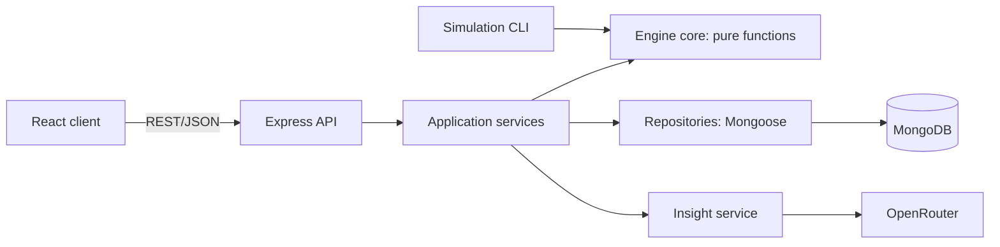

# System Specification: Adaptive Learning Behaviour Analytics System

Author: Chan Hao Hean (TP080141)
Programme: BSc (Hons) Software Engineering, APU
Document status: v0.1 (initial specification, written before any implementation code)

## 0. Provenance

This specification is derived from the author's Investigation Report (IR) and project proposal, and from the published literature those documents cite. The implementation is written from scratch against this document. Every design decision below traces to an IR section or a cited paper.

| Source | Used for |
|---|---|
| IR §1.3–1.4 (aim, objectives) | Functional requirements |
| IR §1.5 (scope, exclusions, constraints) | Scope boundaries, MoSCoW priorities |
| IR §2.3.5, Table 7 (adaptive stages) | Learning-stage state machine |
| IR §2.3.5, Table 8 (memory modelling) | Memory record and scheduling |
| Proposal (8-collection schema, 7 dashboard metrics) | Data model, dashboard |
| Wozniak (1990), SuperMemo SM-2 | Review scheduling |
| Settles & Meeder (2016), Half-Life Regression | Retention estimate |
| Corbett & Anderson (1994), Bayesian Knowledge Tracing | Skill mastery |
| Ebbinghaus (1885) | Forgetting-curve rationale |

---

## 1. Overview

### 1.1 Problem
Static e-learning systems assess correctness but do not model how a learner retains knowledge over time, so revision is not targeted at what the learner is actually forgetting (IR §1.1–1.2).

### 1.2 Solution
A web system that records learner interactions, estimates retention and mastery per concept, selects questions adaptively, visualises progress in plain language, and evaluates itself against a non-adaptive baseline.

### 1.3 Application domain (case study)
Japanese language learning is the case-study domain (IR p10, p19). Content is a small set authored for this project: the 46 basic hiragana and about 50 JLPT N5 vocabulary items. The engine is domain-independent: content is data, and no engine code refers to Japanese.

### 1.4 Target users (IR §1.6)
| Role | Needs |
|---|---|
| Learner | Adaptive practice, plain-language progress and guidance |
| Educator | Aggregate class view: common weak topics, overall trends |
| Researcher (secondary) | Export of interaction data and evaluation results |

### 1.5 Out of scope (IR §1.5.2)
- A full commercial platform or large content library
- Training a custom AI or language model; the LLM is used through an API only
- Native mobile apps; the system is web-based
- Real-user longitudinal studies large enough for statistical claims about humans; objective 6 uses simulation plus the IR survey

---

## 2. Requirements

Priorities use MoSCoW: M = Must, S = Should, C = Could.

### 2.1 Functional requirements

**Accounts and roles**
| ID | Requirement | Pri | Objective |
|---|---|---|---|
| FR-01 | A user can register and log in with email and password. | M | — |
| FR-02 | Each user has a role: `learner` or `educator`. | M | — |
| FR-03 | A learner can view and edit a basic profile (display name, daily goal). | S | — |

**Interaction tracking (Objective 1)**
| ID | Requirement | Pri |
|---|---|---|
| FR-10 | The system records every answer: user, question, skill, selected option, correctness, response time in ms, timestamp, session. | M |
| FR-11 | Response time is measured client-side from question render to answer submit. | M |
| FR-12 | The system records each session: start, end, strategy used, number of questions, accuracy. | M |
| FR-13 | The system records how often each question has been shown to each learner. | M |

**Retention model (Objective 2)**
| ID | Requirement | Pri |
|---|---|---|
| FR-20 | The system keeps one memory record per learner per concept (Table 8 attributes). | M |
| FR-21 | After each answer, the memory record is updated with SM-2 (§5.2). | M |
| FR-22 | The system can estimate current retention probability for any concept at any time (§5.3). | M |
| FR-23 | The system can project retention forward in time if the learner does not review (§5.3). | S |

**Skill mastery (Objective 3)**
| ID | Requirement | Pri |
|---|---|---|
| FR-30 | The system keeps a mastery probability per learner per skill, updated with BKT after each answer (§5.4). | M |
| FR-31 | Skills are classified as `not_started`, `weak`, `developing` or `mastered` from mastery thresholds. | M |
| FR-32 | A skill can declare prerequisite skills; a skill is available only when its prerequisites are mastered. | S |

**Adaptive selection (Objective 4)**
| ID | Requirement | Pri |
|---|---|---|
| FR-40 | The system determines the learner's stage (Table 7) at session start (§5.5). | M |
| FR-41 | The system builds a session from review, weak-skill and new-content pools, with proportions set by stage (§5.6). | M |
| FR-42 | Every selected question stores a machine-readable reason (`due_review`, `weak_skill`, `new_content`, `reinforcement`). | M |
| FR-43 | The system offers a static (non-adaptive) strategy that uses the same interface (§5.7). | M |

**Analytics dashboard (Objective 5)**
| ID | Requirement | Pri |
|---|---|---|
| FR-50 | The learner dashboard shows the 7 proposal metrics: overall accuracy, topic mastery, retention trend, weak concepts, response time, revision progress, learning history. | M |
| FR-51 | Each metric has a plain-language sentence alongside the chart (§7.2). | M |
| FR-52 | The dashboard shows "what to review next" with the reason for each item. | S |
| FR-53 | The dashboard shows a forward retention projection for the learner's weakest concepts. | C |
| FR-54 | The educator dashboard shows class-level weak topics and accuracy trend. | S |
| FR-55 | An AI-generated summary of the learner's recent behaviour is shown, with a template fallback (§6). | S |
| FR-56 | A researcher or educator can export attempts and evaluation results as CSV. | C |

**Evaluation (Objective 6)**
| ID | Requirement | Pri |
|---|---|---|
| FR-60 | A simulation tool runs simulated learners through the adaptive and static strategies under identical conditions (§8). | M |
| FR-61 | The tool outputs results tables and charts for the report. | M |

### 2.2 Non-functional requirements
| ID | Category | Requirement |
|---|---|---|
| NFR-01 | Performance | Session generation completes in under 500 ms for a bank of up to 2,000 questions. |
| NFR-02 | Performance | Dashboard API responses complete in under 1 s for a learner with 5,000 attempts. |
| NFR-03 | Reliability | The engine works with no LLM available; LLM failure never blocks practice or the dashboard (IR p20). |
| NFR-04 | Security | Passwords hashed with bcrypt; JWT auth; all API input validated; secrets only in environment variables. |
| NFR-05 | Security | A learner can only read their own data; educator endpoints require the educator role. |
| NFR-06 | Privacy | Only data needed for the objectives is collected; follows the principles of Malaysia's PDPA 2010. |
| NFR-07 | Usability | Learner-facing text avoids model terms (no "probability", "ease factor"); see §7.2. |
| NFR-08 | Maintainability | The engine is pure functions with no database or HTTP access; unit-test coverage of the engine ≥ 80%. |
| NFR-09 | Reproducibility | Simulations are seeded; the same seed gives identical results. |
| NFR-10 | Compatibility | Works in current Google Chrome on desktop (IR §2.3.6). |

---

## 3. Architecture

### 3.1 Stack (IR §2.3)
| Layer | Technology |
|---|---|
| Client | React + TypeScript (Vite), Zustand, Recharts |
| Server | Node.js + Express + TypeScript |
| Validation | Zod (shared schemas) |
| Database | MongoDB with Mongoose |
| AI | OpenRouter API (LLM) |
| Tests | Vitest |
| Tooling | VS Code, Git, Kanban board (IR Ch. 3) |

### 3.2 Layers



- **Engine core** holds every model and decision as pure functions: input state → output state. It has no I/O, which makes it unit-testable and lets the simulation call it directly.
- **Application services** load state through repositories, call the engine, and persist results.
- **Repositories** are the only code that touches Mongoose.
- **Insight service** is the only code that calls the LLM.

### 3.3 Repository layout
```
adaptive-learning-fyp/
  docs/            SPEC.md, DEVLOG.md, SOURCES.md, report figures
  shared/          Zod schemas and TypeScript types used by client and server
  server/
    src/
      engine/      scheduler.ts, retention.ts, mastery.ts, stage.ts,
                   strategies/{adaptive.ts, static.ts}, index.ts
      services/    practice.service.ts, analytics.service.ts, insight.service.ts
      repositories/
      routes/
      middleware/  auth, validation, error handling
      db/          Mongoose models, seed scripts
    test/
  client/
    src/
      pages/       Practice, Dashboard, Educator, Login
      components/
      store/       Zustand stores
      api/
  simulation/      learner simulator, runner, report generator
  content/         authored question bank (JSON)
```

### 3.4 Request flow: one answer
1. Client submits `{questionId, selectedOption, responseTimeMs}`.
2. Server validates, checks the answer, writes an Attempt.
3. Engine computes the SM-2 quality grade (§5.1), updates the Memory record (§5.2) and the skill's mastery (§5.4).
4. Server persists both and returns correctness, the correct answer and the explanation.

---

## 4. Data model

Eight collections, from the proposal schema.

### 4.1 `users`
| Field | Type | Notes |
|---|---|---|
| _id | ObjectId | |
| email | string | unique, lower-cased |
| passwordHash | string | bcrypt |
| displayName | string | |
| role | `learner` \| `educator` | |
| classCode | string? | groups learners for the educator view |
| createdAt | Date | |

### 4.2 `skills`
| Field | Type | Notes |
|---|---|---|
| _id | string | e.g. `hira-vowels`, `n5-numbers` |
| name | string | |
| topic | string | e.g. `hiragana`, `vocabulary` |
| level | number | ordering within the curriculum |
| prerequisites | string[] | skill ids |
| bkt | `{pInit, pTransit, pSlip, pGuess}` | per-skill parameters (§5.4) |

### 4.3 `questions`
| Field | Type | Notes |
|---|---|---|
| _id | string | |
| skillId | string | |
| conceptId | string | the item being learned, e.g. `kana-a`, `word-mizu` |
| type | `mcq` | |
| prompt | string | |
| options | string[] | 4 options |
| answer | string | |
| explanation | string | |
| difficulty | 1–3 | |

### 4.4 `sessions`
| Field | Type | Notes |
|---|---|---|
| _id | ObjectId | |
| userId | ObjectId | |
| strategy | `adaptive` \| `static` | |
| stage | Table 7 stage at start | |
| plan | `[{questionId, reason}]` | the generated session |
| startedAt / endedAt | Date | |
| summary | `{answered, correct, avgResponseMs}` | |

### 4.5 `attempts`
| Field | Type | Notes |
|---|---|---|
| _id | ObjectId | |
| userId, sessionId, questionId, skillId, conceptId | ids | |
| selected | string | |
| correct | boolean | |
| responseTimeMs | number | |
| quality | 0–5 | SM-2 grade |
| reason | string | why it was selected |
| answeredAt | Date | |

### 4.6 `memories` (Table 8)
| Field | Type | Table 8 attribute |
|---|---|---|
| userId, conceptId | ids | Topic |
| repetitions | number | Successful reviews (consecutive) |
| easeFactor | number | (SM-2) |
| intervalDays | number | Review interval |
| lastReviewedAt | Date | Last reviewed date |
| dueAt | Date | Next review date |
| totalReviews, totalCorrect | number | |
| — | — | Mastery strength: derived as retention (§5.3), not stored |

Unique index on `(userId, conceptId)`.

### 4.7 `knowledgecoverage`
Per learner per skill.
| Field | Type | Notes |
|---|---|---|
| userId, skillId | ids | unique pair |
| pMastery | number | BKT probability |
| status | `not_started` \| `weak` \| `developing` \| `mastered` | |
| attempts, correct | number | |
| firstSeenAt, masteredAt | Date? | |
| history | `[{at, pMastery}]` | capped at last 100 points, for trend charts |

### 4.8 `questionexposures`
| Field | Type | Notes |
|---|---|---|
| userId, questionId | ids | unique pair |
| timesShown | number | |
| lastShownAt | Date | |

---

## 5. Engine specification

All functions live in `server/src/engine` and are pure. `now` is always passed in, never read from the clock, so the simulation can control time.

### 5.1 Answer grading → SM-2 quality
Maps a quiz answer to SM-2's 0–5 grade using correctness and response time.

| Condition | q |
|---|---|
| incorrect | 1 |
| correct, responseTime > slowMs | 3 |
| correct, fastMs < responseTime ≤ slowMs | 4 |
| correct, responseTime ≤ fastMs | 5 |

Defaults: `fastMs = 4000`, `slowMs = 12000`. Both are configuration values and reported in the report.

### 5.2 Review scheduling: SM-2 (Wozniak, 1990)
New concept: `repetitions = 0`, `easeFactor = 2.5`, `intervalDays = 0`.

On each answer with quality q:
```
if q < 3:
    repetitions = 0
    intervalDays = 1
else:
    if repetitions == 0: intervalDays = 1
    elif repetitions == 1: intervalDays = 6
    else: intervalDays = round(intervalDays * easeFactor)
    repetitions += 1
easeFactor = max(1.3, easeFactor + (0.1 - (5 - q) * (0.08 + (5 - q) * 0.02)))
lastReviewedAt = now
dueAt = now + intervalDays days
```

### 5.3 Retention estimate: half-life form (Settles & Meeder, 2016)
Estimated probability the learner still recalls the concept:
```
h = max(intervalDays, 0.5)          # half-life in days
t = days since lastReviewedAt
retention = 2 ^ (-t / h)
```
At the scheduled review time retention is 0.5, which is the point where SM-2 asks for a review. This is the forgetting curve (Ebbinghaus) with a per-concept rate.

Projection (FR-23): evaluate `retention` at `t + d` for `d = 1..14` days.

Bands for display: ≥ 0.8 strong, 0.5–0.8 fading, < 0.5 at risk.

### 5.4 Skill mastery: Bayesian Knowledge Tracing (Corbett & Anderson, 1994)
State per learner per skill: `pL = P(skill known)`, starting at `pInit`.

On each answer to a question of that skill:
```
if correct:
    post = pL * (1 - pSlip) / (pL * (1 - pSlip) + (1 - pL) * pGuess)
else:
    post = pL * pSlip / (pL * pSlip + (1 - pL) * (1 - pGuess))
pL = post + (1 - post) * pTransit
```

Default parameters (per skill, overridable): `pInit 0.2`, `pTransit 0.15`, `pSlip 0.1`, `pGuess 0.25` (four-option MCQ).

Status thresholds:
| pL | Status |
|---|---|
| no attempts | not_started |
| < 0.5 | weak |
| 0.5–0.95 | developing |
| ≥ 0.95 | mastered (Corbett & Anderson's threshold) |

A skill is **available** when it has no prerequisites or all prerequisites are `mastered`.

### 5.5 Learning stage (IR Table 7)
Evaluated at session start, in order; the first rule that matches wins.

| Stage | Rule |
|---|---|
| Cold Start | learner has fewer than 10 attempts in total |
| Adaptive Review | due concepts ≥ 40% of the session size |
| Core Practice | at least one available skill is `weak` |
| Advanced Expansion | every available skill is `mastered` |
| Foundation Building | otherwise (learner is still building the available skills) |

### 5.6 Adaptive strategy
Session size `N` defaults to 10.

**Candidate pools**
- `review`: concepts with `dueAt ≤ now`, ordered by lowest retention first
- `weak`: questions from `weak` skills, ordered by lowest pMastery first
- `new`: questions for concepts never seen, from available skills, ordered by skill level
- `reinforcement`: questions from `developing` skills, ordered by least recently shown

**Pool proportions by stage**
| Stage | review | weak | new | reinforcement |
|---|---|---|---|---|
| Cold Start | 0% | 0% | 100% (lowest level only) | 0% |
| Foundation Building | 20% | 10% | 40% | 30% |
| Core Practice | 20% | 50% | 10% | 20% |
| Adaptive Review | 60% | 20% | 0% | 20% |
| Advanced Expansion | 30% | 0% | 50% (next level) | 20% |

**Filling the session**
1. Take `round(N × share)` items from each pool in table order.
2. If a pool runs short, give the remainder to the next pool in the order review → weak → reinforcement → new.
3. Skip any question shown to this learner in the last 2 sessions unless no alternative exists.
4. No more than 3 questions for the same concept in one session.
5. Shuffle the final list with the session's seed so the order doesn't reveal the pool.
6. Store each question's `reason` (FR-42).

### 5.7 Static strategy (baseline)
Models a conventional fixed-sequence course.
- Questions are ordered once by skill level, then by question id.
- Each session takes the next `N` questions in that order and wraps to the start at the end.
- No review scheduling, no mastery gating, no prerequisite checks.
- It records attempts and updates memory and mastery the same way, so both strategies are measured with the same instruments.

Both strategies implement the same interface:
```ts
interface SelectionStrategy {
  name: 'adaptive' | 'static';
  buildSession(input: LearnerSnapshot, bank: Question[], now: Date, n: number, seed: number): PlannedItem[];
}
```

---

## 6. AI insight service (IR §2.3.5)

- **Input:** a structured JSON summary only (accuracy, weakest 3 skills, at-risk concepts, streak of sessions, average response time trend). No raw personal data is sent.
- **Output:** 2–3 short plain-language sentences of guidance.
- **Model access:** OpenRouter; model name in configuration.
- **Caching:** one insight per learner per day.
- **Fallback:** if the call fails or times out (5 s), a deterministic template builds the sentences from the same summary.
- **Boundary:** the LLM never selects questions or changes any model state. It only explains (IR p78: AI is not the sole decision-maker).

---

## 7. Dashboard

### 7.1 Learner dashboard: the 7 proposal metrics
| Metric | Chart | Data |
|---|---|---|
| Overall accuracy | number + 14-day line | attempts |
| Topic mastery | bar per skill, coloured by status | knowledgecoverage |
| Retention trend | line of mean retention over time | memories (computed daily) |
| Weak concepts | list, lowest retention first | memories |
| Response time | line of median response time per session | attempts |
| Revision progress | due today / done today / overdue | memories |
| Learning history | session list with accuracy | sessions |

### 7.2 Plain-language rules
Every chart has one sentence generated from the data. Examples:
| Data | Sentence |
|---|---|
| retention < 0.5 | "You're starting to forget **{concept}**. A quick review today will bring it back." |
| skill weak | "**{skill}** needs more practice. Your next session will focus on it." |
| skill newly mastered | "You've mastered **{skill}**." |
| median response time falling | "You're answering faster than last week." |
| projection | "If you don't review **{concept}**, you'll likely forget it in about {d} days." |

Learner-facing text never shows raw probabilities, ease factors or stage names.

### 7.3 Educator dashboard
For learners sharing the educator's `classCode`: class accuracy trend, the 5 most common weak skills, and the number of learners per stage.

---

## 8. Evaluation design (Objective 6)

### 8.1 Simulation
- **Simulated learner:** each has a hidden "true" knowledge state per concept. Learning on a correct exposure follows a per-learner learn rate; forgetting follows a per-learner, per-concept true half-life that grows with successful spaced reviews; answers are sampled with slip and guess noise; response times are sampled from a log-normal distribution.
- **Avoiding circularity:** the simulator's true parameters are drawn from distributions and are **not** the engine's BKT or SM-2 parameters, so the engine has to estimate a state it cannot see.
- **Design:** 100 simulated learners × 2 strategies × 30 sessions of 10 questions, one session per simulated day. Each learner uses the same seed under both strategies (paired design).
- **Post-test:** 7 simulated days after the last session, test every concept once with no learning.

### 8.2 Metrics
| Metric | Meaning |
|---|---|
| Post-test recall | % of concepts recalled on the delayed post-test (primary) |
| Skills mastered | number of skills reaching true mastery |
| Questions to mastery | mean questions needed per mastered skill |
| Wasted repetition | % of questions on concepts the learner already knew strongly |
| Coverage | % of the bank's concepts seen at least once |

### 8.3 Analysis
- Paired comparison per learner; report mean, standard deviation and a paired t-test (or Wilcoxon signed-rank if not normal), with p-values and effect size.
- Sensitivity check: rerun with session sizes 5 and 20 and with fast versus slow simulated forgetters.
- Output: CSV plus charts (recall over days for each strategy) for the report.

### 8.4 Supporting evidence
- The IR survey (Ch. 3) as user-perception evidence.
- Optional small usability test with 3–5 learners using a short questionnaire, if time allows.

---

## 9. API

All routes are prefixed with `/api/v1`. All except auth require a JWT.

| Method | Route | Purpose | FR |
|---|---|---|---|
| POST | /auth/register | create account | FR-01 |
| POST | /auth/login | get token | FR-01 |
| GET | /me | profile | FR-03 |
| POST | /practice/sessions | build a session `{strategy?}` | FR-40–43 |
| POST | /practice/sessions/:id/answers | submit an answer | FR-10–30 |
| POST | /practice/sessions/:id/finish | close a session | FR-12 |
| GET | /dashboard/summary | the 7 metrics | FR-50–51 |
| GET | /dashboard/next-up | review list with reasons | FR-52 |
| GET | /dashboard/projection | retention projection | FR-53 |
| GET | /dashboard/insight | AI summary | FR-55 |
| GET | /educator/classes/:code/overview | class view (educator only) | FR-54 |
| GET | /export/attempts.csv | data export | FR-56 |

Errors use a single shape: `{ error: { code, message } }`.

---

## 10. Content

- Authored in `content/*.json` for this project, validated by a Zod schema on seed.
- **Hiragana:** 46 basic characters, one skill per row (10 skills); questions kana → romaji and romaji → kana.
- **N5 vocabulary:** about 50 words across 5 topic skills (numbers, greetings, family, food, time); questions word → meaning and meaning → word.
- Prerequisites: vocabulary skills require the hiragana rows their words use.
- Distractors are other items from the same skill.

---

## 11. Testing

| Level | What | Tool |
|---|---|---|
| Unit | Every engine function, including the published worked examples for SM-2 and BKT | Vitest |
| Property | Retention is always in [0, 1]; mastery is always in [0, 1]; session never exceeds N | Vitest |
| Integration | API routes against an in-memory MongoDB | Vitest + mongodb-memory-server |
| System | Manual test cases per FR in the report appendix | — |
| Evaluation | Simulation is reproducible with a fixed seed (NFR-09) | Vitest |

---

## 12. Traceability

| Objective | FRs | Engine module | Evidence in report |
|---|---|---|---|
| 1 Interaction tracking | FR-10–13 | — (services) | attempt records, screenshots |
| 2 Retention model | FR-20–23 | scheduler.ts, retention.ts | unit tests, retention chart |
| 3 Skill mastery | FR-30–32 | mastery.ts | unit tests, mastery chart |
| 4 Adaptive selection | FR-40–43 | stage.ts, strategies/ | session plans with reasons |
| 5 Dashboard | FR-50–56 | — (client) | dashboard screenshots |
| 6 Evaluation | FR-60–61 | simulation/ | results tables, statistical tests |

---

## 13. Build plan (Kanban, IR Ch. 3)

| Week | Deliverables |
|---|---|
| 1 | Repo scaffold, shared schemas, engine core (§5) with unit tests, content files |
| 2 | Mongoose models, repositories, auth, practice API, seed script |
| 3 | Client: login, practice screen, learner dashboard with plain-language text; insight service |
| 4 | Simulation and results; educator view if time allows; report figures |

Definition of done for each card: code, tests passing, a DEVLOG.md entry, and the FR ids it closes.

---

## 14. References
- Corbett, A. T., & Anderson, J. R. (1994). Knowledge tracing: Modeling the acquisition of procedural knowledge. *User Modeling and User-Adapted Interaction*, 4(4), 253–278.
- Ebbinghaus, H. (1885). *Über das Gedächtnis*.
- Settles, B., & Meeder, B. (2016). A trainable spaced repetition model for language learning. *Proceedings of ACL*.
- Wozniak, P. A. (1990). *Optimization of learning* (SuperMemo SM-2 algorithm).
